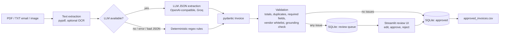

# AI Invoice Intake

Extract, validate and route vendor invoices for a small bookkeeping firm: clean invoices go to an **approved CSV** (accounting-import style), uncertain ones to a **human review queue**.

> **All data is synthetic.** Vendors, invoices and amounts are fictional, generated by `invoice_intake/synth.py` (seeded, reproducible). No real customer documents were used.

## How it works



Validation checks: required fields (vendor, number, date, total), line items sum to subtotal, subtotal + tax = total, duplicate detection (same file hash, or same vendor + invoice number), vendor whitelist (`data/whitelist.txt`), due-date order, and a **grounding guard** (an extracted invoice number / total must literally appear in the source text, which catches LLM hallucinations). The LLM is optional: any API error, timeout or schema-invalid output silently falls back to the rule extractor.

## Run it

```bash
pip install -r requirements.txt
cp .env.example .env   # optional: LLM_API_KEY, LLM_BASE_URL, LLM_MODEL (any OpenAI-compatible API); without it rules are used
python -m invoice_intake.synth                 # 32 synthetic invoices -> data/invoices (+ ground_truth.json)
uvicorn invoice_intake.api:app                 # POST /invoices, GET /invoices, POST /invoices/{id}/review, GET /export.csv
streamlit run invoice_intake/ui.py             # upload + review queue + CSV download
python -m invoice_intake.evaluate --mode rules llm   # accuracy report -> reports/
pytest
```

## Results (32 synthetic documents, mixed PDF and emailed-text)

32 docs: 18 clean, 4 noisy (OCR-style corruption), 3 total mismatches, 2 missing invoice numbers, 1 missing date, 2 duplicates, 2 non-whitelisted vendors. Precision = correct / predicted (non-null) fields; R = recall.

| Field | rules P / R | llm P / R |
|---|---|---|
| vendor | 100% / 100% | 100% / 100% |
| invoice_number | 100% / 77% | 100% / 97% |
| invoice_date | 100% / 90% | 100% / 97% |
| due_date | 100% / 100% | 100% / 100% |
| subtotal | 100% / 100% | 100% / 100% |
| tax | 100% / 100% | 100% / 100% |
| total | 100% / 100% | 100% / 100% |
| line_items | 100% / 100% | 99% / 99% |
| extractor used | rules: 32 | llm: 28, rules: 4 |
| **routing accuracy** | 78% | 97% |
| **false approvals** | 0 of 15 approved | 0 of 21 approved |
| **injected errors caught** | 10 / 10 | 10 / 10 |

Model: `openai/gpt-oss-20b` via Groq (4 of 32 requests fell back to rules, which is the designed behaviour). Re-run to reproduce; LLM numbers vary slightly between runs. Full output: `reports/accuracy.json`.

Take-aways: the rules never emit a wrong value on this data (they return nothing instead, so the document is routed to review); the LLM recovers noisy documents, lifting routing accuracy from 78% to 97%. No invalid invoice was auto-approved in either mode, and every injected error was flagged.

## Limitations

- **Synthetic, template-based data**: three layouts in a single currency (USD). Real invoices are far messier; the 100% precision numbers will not transfer. The rule extractor is tuned to these layouts.
- Image/scanned-PDF input needs OCR (`pytesseract` + Tesseract) which is optional and not covered by tests/benchmark; without it such files go to review as `UNREADABLE`.
- Floats are used for money with a 0.02 tolerance (use `Decimal` for production).
- One-page assumptions, no multi-currency/tax-ID handling, no auth on the API/UI, SQLite only.
- Sending real invoices to a hosted LLM has privacy implications; use a local model for sensitive data.
- Small benchmark (32 docs): treat percentages as indicative.

## Layout

`invoice_intake/` schema · extract (LLM + rules) · validate · db (SQLite, CSV export) · pipeline · api (FastAPI) · ui (Streamlit) · synth · evaluate; `tests/`; `data/` sample synthetic invoices; `reports/` accuracy output.
